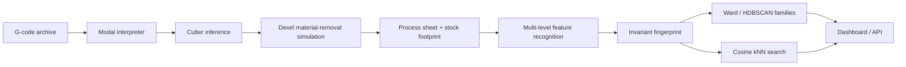

# NC-Archaeologist

Recover the machined part, the process plan and the Group-Technology part family of a CNC milling program **from the G-code alone**, with no CAD model, drawing or labels.

Shops accumulate thousands of NC programs whose CAD files are gone. The same part may exist in several programs written for different controllers, units and fixturings, and no two of them look alike as text. NC-Archaeologist treats each program as an executable description of geometry: it interprets the program, simulates material removal on a dexel height map, recognises machining features on the result, and compares programs by a rotation- and translation-invariant fingerprint of *what they make*.

Developed as the course project for BMEE401L *Computer Integrated Manufacturing*. The accompanying IEEE-format paper is in [`paper/main.pdf`](paper/main.pdf).

---

## Results (held-out test set, 600 programs)

All parameters were tuned on a development set (seed 7). The numbers below are from a separate test set (seed 11), produced by `experiments/run_all.py` and written to `results/metrics.json`.

| Task | Metric | NC-Archaeologist | Text TF-IDF baseline |
|---|---|---|---|
| Part-family discovery (Ward, k = 8) | Adjusted Rand Index | **0.797** | 0.074 |
| | NMI / purity | 0.822 / 0.907 | 0.197 / 0.232 |
| Similar-program retrieval | Precision@5 / mAP | **0.939** / 0.851 | 0.558 / 0.205 |
| Part recovery, tools named in comments (n = 448) | removed-volume IoU / median RMS | **0.999** / 0.11 mm | n/a |
| Part recovery, all programs | IoU | 0.925 | n/a |
| Hole detection | recall / precision / position MAE | 100% / 99.9% / 0.18 mm | n/a |
| Same part posted in 4 dialects (40 parts) | mean cosine similarity | 0.92 (other families: −0.08) | n/a |

Text-based clustering agrees with the *dialect* labels (ARI 0.61) far more than with the part families (ARI 0.07). It learns how a program is written, not what it makes. Ablation: geometry block alone 0.618 ARI, process block alone 0.572, combined 0.797.

Mean runtime is about 1.7 s per program on a laptop CPU (parallel across cores).

---

## Pipeline



### 1. Interpreter (`ncarch/gcode/parser.py`, `arcs.py`)
A tokenizer plus modal state machine following ISO 6983. The state tracked is motion mode, units, distance mode, feed, spindle, active and pending tool, canned-cycle words and the G98/G99 retract plane. The output is a flat list of straight `Segment`s in millimetres and absolute coordinates, each carrying tool, feed, spindle and source line number.

| Supported | Handling |
|---|---|
| G0/G1, G2/G3 (IJK and R, helical), G17 | arcs linearised at 0.05 mm chord tolerance |
| G20/G21, G90/G91 | converted to mm, absolute |
| G81/G82/G83, G98/G99, G80 | expanded to rapid → R-plane → feed → retract; peck count kept for cycle time |
| T…M6, tool comments | `(T3 D6.0 FLAT)`, `T2 M06 (D10 FLAT EM)`, `(T4 0.25 IN BALL)` |
| Fanuc `M98 P… L…` / `O… M99`, LinuxCNC `o-sub` / `o-call` | subprograms defined in the same file are inlined |

Constructs that cannot be executed faithfully produce explicit warnings rather than guessed geometry: G41/G42 cutter compensation, Macro B variables and control flow, external subprogram calls, non-XY planes, and lathe programs (detected from T0101-style tool words, G96/G97, G18 and G70–G72).

A comment counts as a tool definition only if it names a tool number or sits on the tool-change line, so section notes like `(POCKET: 10 MM END MILL)` are ignored.

### 2. Cutter inference (`ncarch/sim/tools.py`)
When a tool's diameter is not stated, it is estimated from a **raster run**: at least three alternating, antiparallel, equal-Z passes joined by short link moves with no rapid in between. The perpendicular pass spacing is the step-over *s*, and

```
D̂ = snap(s / 0.5)        snap → nearest standard cutter {1,2,3,4,5,6,8,10,12,16,20,25,32,40,50,63}
```

Requiring the alternating pattern rejects look-alikes: separate parallel slots, or the two long sides of a profile loop. A single shallow Z level of long passes is treated as facing with a 0.7 ratio. Drills, and tools with no raster run, fall back to 6 mm and are flagged. On comment-free programs this covers 55% of milling tools, 82% of them within one standard size.

### 3. Material-removal simulation (`ncarch/sim/stock.py`)
The stock is a height map `Z[i, j]` (default 0.25 mm cells) over the XY extent of all cutting moves plus the cutter radius. The stock top is taken as Z = 0, or as the highest cutting level if no move goes below zero. Each feed move updates

```
Z[i,j] ← min(Z[i,j],  z(t*) + h(r_ij))
h(r) = 0 (flat) | R − √(R² − r²) (ball) | r / tan 59° (118° drill) | r (90° chamfer)
```

For flat cutters the minimum over a ramping move is computed in closed form from the end points of the parameter interval covered by each cell, so no sampling is needed. Shaped cutters are sampled at ≤ 0.75 × cell size. Per-tool-block removal masks and volumes are kept for process analysis. `sim/mesh.py` turns the height map into a watertight mesh (STL export) and a compact int16 payload for the browser.

### 4. Process sheet and stock footprint (`ncarch/analysis/process.py`)
The program is split at tool changes. Each block is classified from the region it removed:

| Rule (in order) | Operation |
|---|---|
| drill-type tool, or XY travel < 5% of Z travel | drilling (count = distinct plunge points) |
| removed depth ≤ 1.6 mm and coverage > 45%, or one shallow level with a face mill | facing |
| enclosed uncut area larger than the cut ring | profiling |
| region runs past the stock edge | step milling |
| enclosed island > max(3% of area, 20 mm²) | island pocketing |
| aspect > 2.5 and width < 1.6·D | slotting |
| aspect < 1.15 and bounding-box fill < 0.86 | bore |
| otherwise | pocketing |

Cycle time = Σ length/feed + rapids at 10 m/min + 8 s per tool change + 1 s per peck. G-code never states the stock size, so the **stock footprint** is estimated from the facing toolpath: the pass envelope, contracted by R along the passes (facing overruns the stock ends) and grown by R/2 across them.

### 5. Feature recognition (`ncarch/analysis/geometry.py`)
Flat-floor depths are found from cells with slope < 0.05, which keeps drill cones and scallops from creating levels. They are binned at 0.5 mm, and levels closer than 0.75 mm are merged. Thresholds sit midway between successive floors. At each level, connected regions are extracted after morphological closing and opening; each becomes a feature whose parent is the region containing it one level up. A region identical to its parent (≥ 95% of the same cells) is not repeated.

| Label | Criterion |
|---|---|
| outline | enclosed uncut area > cut area (the part inside a profile ring) |
| step | open to the stock edge (footprint) or along exactly three sides of the machined domain |
| pocket_island | enclosed island > max(3% of area, 20 mm²) |
| hole / circular_pocket | circularity > 0.75, aspect < 1.3, fill ratio < 0.86; hole if Ø ≤ 14 mm |
| slot | aspect > 2.5, width < 16.5 mm |
| pocket | otherwise |

The fill ratio separates circles (π/4 ≈ 0.785) from rounded squares (≈ 1), which share equal principal axes. Hole patterns are reported as a bolt circle when the radii agree within 5% *and* the angular gaps agree within 10%; rectangle corners are concyclic too, so the second test is needed.

### 6. Fingerprint, families and search (`ncarch/analysis/fingerprint.py`, `ncarch/families/`)
The fingerprint has 75 dimensions:
- **Geometry (46).** It is computed on a design-depth image with facing, the profiling ring and cuts outside the stock footprint removed. Those depend on the blank supplied, not on the design. It contains a 12-bin depth histogram (relative to the deepest cut), the 7 Hu moment invariants (log-scaled), a 12-bin radial depth profile normalised by the radius of gyration, 7 log feature counts, and 8 shape terms (elongation, normalised hole size, bolt-circle flag, cut fraction, through-depth fraction, largest-feature share, nesting, mean aspect). All are invariant to rotation and translation.
- **Process (29).** Per-operation time share, presence and log count (9 operation types × 3), plus log tool count and log tool changes.

Each block is z-scored, weighted 0.5 / 0.5 (chosen on the development set) and divided by √dim so the 46-dimensional block does not dominate. Families come from Ward agglomerative clustering; with unknown k, the silhouette score over k = 4…12 is used and selects 9 (the true value is 8). HDBSCAN (min cluster size 15, min samples 5) gives density-based families and flags outliers. Retrieval is cosine kNN, and the archive map is t-SNE (display only).

---

## Benchmark (`ncarch/datagen/`)

No public collection of CNC programs with part-family labels exists, so the benchmark is synthetic, with exact ground truth.

- **8 parametric families** (`families.py`): bolt-hole plate, pocket housing, slotted bracket, flange, stepped block, multi-pocket tray, keyway bar, boss (island in pocket). Dimensions, counts, depths and cutters are randomised; facing (85%) and outline profiling (40–60% depending on family) are optional.
- **Mini CAM** (`cam.py`): zig-zag or offset-spiral pocketing, concentric bores, multi-level slots, shoulder rasters for steps, peck or canned drilling, climb or conventional profiles with corner arcs. Step-over 40–60%, step-down 1.5–3.5 mm.
- **Four post-processors** (`post.py`):

  | Dialect | Characteristics |
  |---|---|
  | `fanuc` | N-numbers, IJ arcs, G83/G81 with G98, tool comments `(T3 - 6.0 MM FLAT ENDMILL)` |
  | `haas` | R-form arcs, G81/G83 with G99, `T5 M06 (D10 FLAT EM)` |
  | `minimal` | no comments, arcs linearised to chords, explicit peck moves, modal G-words dropped |
  | `inch_inc` | G20 inches, G91 incremental moves (rounding-drift-free), inch tool comments |

- **Random fixturing:** rotation (50% at 0°, 25% at a multiple of 90°, 25% arbitrary) and a work zero at the stock centre or corner, with ±3 mm jitter.
- File names (`O####.nc`) carry no family information. Ground truth (`data*/gt/*.json`) holds the family, the design spec, the tool table and an analytic design-depth function, and is used only for evaluation.

The repository also contains six **hand-written programs** (`samples/handwritten/`) that exercise vendor constructs the generator does not produce: cutter compensation, a Haas subprogram, a Fanuc Macro B bolt circle, a helical entry without comments, LinuxCNC o-word subroutines and a lathe program. The paper reports their results honestly, including two misclassifications.

---

## Repository layout

```
ncarch/
  gcode/       parser.py      modal interpreter, subprogram expansion, warnings
               arcs.py        G2/G3 linearisation (IJK and R forms)
  sim/         tools.py       cutter profiles, raster-run diameter inference
               stock.py       dexel height map, closed-form flat-cutter sweep
               mesh.py        watertight mesh / STL, web payload
  analysis/    process.py     process sheet, facing detection, stock footprint
               geometry.py    multi-level nesting-aware feature recognition
               fingerprint.py 75-D invariant fingerprint
  families/    cluster.py     block scaling, Ward + silhouette, HDBSCAN, t-SNE
               search.py      cosine kNN
  datagen/     families.py    8 part families + analytic ground truth
               cam.py         mini CAM (toolpaths)
               post.py        4 post-processor dialects
               generate.py    benchmark generator CLI
  pipeline.py  batch analysis of a program folder → out_*/
  api.py       FastAPI back end for the dashboard
web/           dashboard (vanilla JS modules, Three.js, Plotly)
experiments/   run_all.py (all paper metrics + figures), make_numbers.py (→ paper/numbers.tex)
paper/         main.tex (IEEEtran), main.pdf, figs/, numbers.tex (generated)
data/          development benchmark (seed 7): programs/ + gt/
data_test/     held-out benchmark (seed 11): programs/ + gt/
out_test/      analysed test archive loaded by the dashboard
results/       metrics.json, per_program.json
samples/       handwritten/, same_part/ (one part × 4 dialects), playground_starter.nc
docs/          learning guide, question bank, demo script, viva cheat sheet
tests/         pytest suite (interpreter, simulator, inference)
```

---

## Installation

Requires Python 3.11+ (developed on 3.14, Windows 11).

```bash
python -m venv .venv
.venv/Scripts/activate            # Windows   (Linux/macOS: source .venv/bin/activate)
pip install numpy scipy scikit-learn scikit-image trimesh matplotlib fastapi uvicorn python-multipart pytest
pytest -q tests
```

On Windows, if the project sits in a deeply nested folder, put the virtual environment on a short path (e.g. `C:\ncarch-venv`) to avoid the 260-character path limit during `pip install`.

## Usage

```bash
# analyse any folder of .nc / .ngc / .tap / .gcode files
python -m ncarch.pipeline path/to/programs out_myshop            # add --stl to export meshes

# run the dashboard on an analysed archive (default: out_test)
NCARCH_OUT=out_myshop python -m uvicorn ncarch.api:app --port 8765
# then open http://127.0.0.1:8765   (plain http, not https)
```

Single program from Python:

```python
from ncarch.pipeline import analyze_text
rec = analyze_text(open("samples/same_part/flange_haas.nc").read(), "flange")
rec["description"]   # '5x hole Ø7 on PCD 53, 1x outline, 1x circular pocket'
rec["process"]       # list of operations: tool, Ø, operation, depth, feed, time …
rec["warnings"]      # anything that could not be executed faithfully
```

## Reproducing the paper

```bash
python -m ncarch.datagen.generate data      --per-family 75 --seed 7
python -m ncarch.datagen.generate data_test --per-family 75 --seed 11
python -m ncarch.pipeline data_test/programs out_test
python -m experiments.run_all --data data_test --out out_test      # ~10 min, writes results/ and paper/figs/
python -m experiments.make_numbers                                 # results/metrics.json → paper/numbers.tex
cd paper && pdflatex main.tex && pdflatex main.tex
```

`paper/numbers.tex` is generated, so every number in the paper comes from `results/metrics.json`.

---

## Dashboard

| Page | Contents |
|---|---|
| Explorer | t-SNE archive map (click a point), auto-named families, 3D recovered part with toolpath overlay, **machining replay** (browser-side height-map update, current G-code line and operation shown), process sheet linked to G-code lines, features, similar programs with side-by-side comparison, STL download |
| How it works | the six stages with live values from the selected program, including its fingerprint |
| Same part ×4 | one part in four dialects, recovered geometry and pairwise similarity matrix |
| Playground | edit or type G-code and run the full pipeline in place |
| Results | metrics and figures from `results/metrics.json` |
| Glossary | definitions of all terms; ⓘ icons on every panel |
| Demo tour | 14-step guided presentation with speaker notes (← / → / N / Esc) |

### API

| Method | Path | Description |
|---|---|---|
| GET | `/api/index` | archive programs (t-SNE coordinates, family, description) and family labels |
| GET | `/api/program/{id}` | full record: process sheet, features, height map, toolpath, stages, G-code |
| GET | `/api/similar/{id}?k=6` | nearest programs by fingerprint |
| GET | `/api/compare?a_id=&b_id=` | two records plus their cosine similarity |
| GET | `/api/fingerprint/{id}` | raw geometry and process vectors |
| POST | `/api/identify` | multipart upload → analysis, family assignment, neighbours |
| POST | `/api/analyze` | JSON `{text, name}`; same as identify, for the playground |
| POST | `/api/identify_sample?path=` | analyse a bundled sample |
| GET | `/api/dialects?part=flange\|boss` | same part in four dialects with similarity matrix |
| GET | `/api/results` | `results/metrics.json` |
| GET | `/api/stl/{id}` | STL of the recovered part (generated on first request) |

---

## Limitations

- **Synthetic benchmark.** The families, CAM strategies and dialects were designed by us. Real archives contain strategies the generator does not produce (adaptive clearing, trochoidal slots, 3D surfacing). Validation on a real shop archive is the main open item.
- **2.5D model.** One height per XY cell: 3-axis prismatic parts only, no undercuts or 4/5-axis work.
- **Unknown cutters and stock.** Drill diameters cannot be inferred from geometry. Without a facing pass the stock edge is unknown, and pockets at the edge of the machined area can be labelled as steps.
- **Not executed:** Macro B, cutter compensation G41/G42, and subprograms stored in other files. All are flagged.

## References

Key related work is cited in the paper. The most relevant:
- N. G. Tsoutsos, H. Gamil, M. Maniatakos, *Secure 3D printing: reconstructing and validating solid geometries using toolpath reverse engineering*, ACM CPSS 2017
- W. Kiński, W. Sobieski, *Geometry extraction from GCODE files destined for 3D printers*, Technical Sciences 23(2), 2020
- H. Opitz, *A Classification System to Describe Workpieces*, Pergamon, 1970
- T. Van Hook, *Real-time shaded NC milling display*, SIGGRAPH 1986
- M.-K. Hu, *Visual pattern recognition by moment invariants*, IRE Trans. Inf. Theory, 1962

## Author

Sanjit Patibanda, School of Mechanical Engineering, Vellore Institute of Technology, Chennai.
